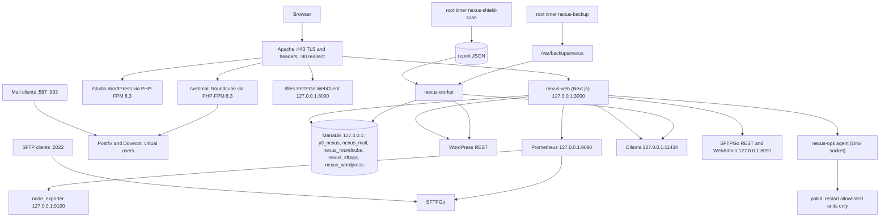
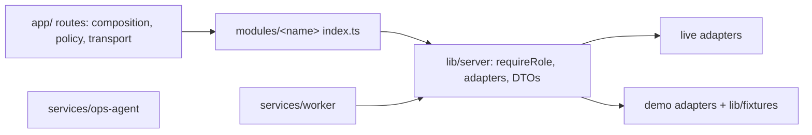

# Design Document

## Overview

YTL Nexus is one Next.js 16.3.5 application (TypeScript strict, Node.js 24 LTS) plus host services on a single Rocky Linux server, Nexus_Core_01. Apache is the only public entry point and routes by path. Every backing service listens on Loopback or a Unix socket. This design adds no architecture beyond what `docs/tech.md`, `docs/structure.md`, `docs/security.md`, `docs/design-language.md`, `docs/product.md` and `docs/spec/10` to `23` already decide. Requirement numbers below refer to `requirements.md`.

Key decisions (all already fixed in the docs):

- **One hostname, path routing.** Apache serves `/studio`, `/webmail` and `/files` itself and proxies everything else to `127.0.0.1:3000`. SSE routes disable buffering.
- **Two interchangeable adapter sets.** Each of eight server adapters has a `live` and a `demo` implementation chosen once from `NEXUS_MODE`. Demo mode opens no connection to any live service.
- **One authorization guard.** `requireRole(minRole)` runs inside every page, layout, Route Handler and Server Function. The proxy only redirects; it is never the sole check.
- **No shell from the web.** OS actions go through `nexus-ops`, which accepts three typed operations on a fixed unit allowlist, with HMAC, timestamp, nonce and polkit as the gates.
- **Root timers write, the web reads.** Backups, restore tests and Shield scans run as root and write JSON or INSERT-only rows. The worker ingests. The web never runs them.
- **Single `nexus-web` instance.** One in-process Prometheus poller fans out over SSE; the local cache is sufficient.

## Architecture



### Layering inside the repository



Rules from `docs/structure.md`: other modules import only from `modules/<name>` (never a private subpath); `lib/server` starts with `import "server-only"` and returns minimal DTOs; Route Handlers hold no business rules.

### Performance budgets (Requirement 18)

| Budget                               | Limit                                                                                                                            | Enforcement                                                                                     |
| ------------------------------------ | -------------------------------------------------------------------------------------------------------------------------------- | ----------------------------------------------------------------------------------------------- |
| First-load JavaScript per route      | 170 KB gzip or less                                                                                                              | Lighthouse CI on the mid-range laptop profile (4x CPU slowdown, 10 Mbps); build fails on breach |
| LCP                                  | under 2.5 s                                                                                                                      | same                                                                                            |
| CLS                                  | under 0.1                                                                                                                        | same                                                                                            |
| INP                                  | under 200 ms                                                                                                                     | same                                                                                            |
| Visual regression                    | at most 0.1% differing pixels at 390, 768, 1440, 2560, 3840 px                                                                   | CI snapshot job                                                                                 |
| Public handler rate limit            | 60 requests per minute per client                                                                                                | rate limiter, error carries retry time                                                          |
| Other bounds already in requirements | `/api/health/ready` DB check 2 s; Atlas panel 500 ms; revalidation 5 s; ops restart ack 2 s; AI stop 2 s; particle resume 500 ms | module tests                                                                                    |

Heavy libraries (react-three-fiber, the Atlas graph library, charts) are lazy-loaded so route budgets hold; the Atlas shows its list view before the graph loads (Req 10.10).

## Components and Interfaces

### Cross-cutting core (`lib/server`, `lib/fixtures`) – Req 1, 5, 6

```ts
type Role = "viewer" | "member" | "operator" | "admin";
type Actor = { userId: string; role: Role } | null; // null = Visitor
const ROLE_RANK: Record<Role, number> = {
  viewer: 1,
  member: 2,
  operator: 3,
  admin: 4,
};

// Mode and adapters
function readMode(env: NodeJS.ProcessEnv): "live" | "demo"; // throws naming NEXUS_MODE and accepted values
interface Adapters {
  db: DbAdapter;
  auth: AuthAdapter;
  wordpress: WordPressAdapter;
  prometheus: PrometheusAdapter;
  ollama: OllamaAdapter;
  sftpgo: SftpgoAdapter;
  ops: OpsAdapter;
  mail: MailAdapter;
}
function getAdapters(): Adapters; // chosen once from NEXUS_MODE; demo set never opens a socket

// Guards (each throws a typed refusal after writing an Audit_Event)
function requireRole(min: Role): Promise<Actor & {}>;
function requireStepUp(): Promise<void>; // password + TOTP within 10 minutes
function parseInput<T>(schema: ZodType<T>, raw: unknown, ctx: AuditCtx): T; // refuses + audits on failure
function audit(e: AuditEventInput): Promise<void>; // actor, role, action, target, result, ip, ts
function rateLimit(key: string, limit: number, windowMs: number): RateResult;
```

- Demo fixtures are pure functions of a fixed seed, so equal requests return equal data (Req 1.9). A `<LiveDemoLabel source="fixture|live"/>` component wraps every displayed value (1.10, 3.7).
- A network guard test double replaces `fetch`, `net.connect` and DB drivers in demo-mode tests and fails on any call (1.11, 1.12).
- Data access uses Kysely with `mysql2` and typed schema; all queries are parameterized (5.9). Zod runs before any statement (5.10).
- Auth is Better Auth on MariaDB with admin plugin (impersonation off), two-factor TOTP, rate limiting and `nextCookies()` last. Cookies are `Secure`, `HttpOnly`, `SameSite=Lax`. Sessions end after 30 minutes idle or 12 hours absolute. Lockout after 5 failures in 15 minutes per account or IP, for 15 minutes (6.1, 6.15 to 6.18).
- `proxy.ts` redirects session-less requests to `/signin`; it is a convenience, not authorization (6.7, 6.8).
- Non-admin requests under `/control/*` return the same 404 body as an unknown path and are audited as refused (6.11).
- CSP header on every HTML response (18.4). Public handlers are limited to 60 requests per minute per client (18.5).

### 1. Platform foundation and tooling – Req 1

Pre-commit hook runs gitleaks, format check and lint, exits non-zero and prints check name plus findings. CI stages: secret scan, format, lint, typecheck, unit tests, build, e2e smoke; the failing stage is named. `NEXUS_MODE=demo` build and start must work offline and render every route. The demo session switcher offers exactly four roles and is labelled "Demo session". `docs/PROGRESS.md` records each file move or deletion with path and date.

### 2. Brand assets and design system – Req 2

- `scripts/assets/convert` turns each vector master into one kebab-case SVG plus one sRGB PNG and appends an entry to `assets/asset-manifest.md` (original name, checksum, new name, placement, variant, alt text).
- `scripts/assets/check-names` is a CI step that fails listing each offending path.
- `app/globals.css` defines tokens in Tailwind v4 `@theme`. Components use semantic tokens only; a lint rule rejects raw hex in component source.
- `<Logo variant height>` enforces minimum height 31 px, preserved aspect ratio and clear space equal to the Nine Pillars symbol height, with no recolour, rotation or stretch.
- `<StatusBadge state>` always pairs colour with icon and text; green, amber and red appear only here.
- Fonts via `next/font/local`; no network fetch at build. `/design` is guarded with `requireRole("viewer")`.

### 3. App shell, navigation and motion – Req 3

```ts
type NavItem = {
  label: string;
  href: string;
  minRole: Role | null;
  children?: NavItem[];
};
function visibleNav(items: NavItem[], actor: Actor): NavItem[]; // role filter, Visitor sees minRole === null only
```

- Route groups: `(public)` editorial layout, `(workspace)` dense dark layout, `(yes)/yes`, `control`. A page or stub exists for every route in `docs/product.md`.
- Each page: one skip link first in focus order, `header/nav/main/footer`, one `h1`. Workspace and `/control` pages emit `noindex`.
- Root wraps the app in `MotionConfig reducedMotion="user"`. `<ParticleField services quality>` is lazy-loaded; `ParticleQuality` tier drops when DPR is above 2, device memory is under 4 GB, or the 60-frame average exceeds 20 ms. It pauses when the tab is hidden and resumes within 500 ms. Reduced motion renders one static frame.
- Particles and parallax never appear on forms, tables, `/control` or the mail inbox.
- Contrast, focus (3:1), 44 px touch targets and axe checks at 390, 1440 and 3840 px are verified by Playwright with axe.

### 4. Server preparation and deployment – Req 4

Delivered as scripts and documents under `infrastructure/` and `docs/operations/`, not application code.

- `infrastructure/scripts/preflight.sh` verifies hostname, IP 10.26.64.164 and machine ID against recorded values and refuses to continue on mismatch.
- `backup-preflight.sh` creates the preflight backup (all DB dumps, `/var/www`, service config, mail storage, Podman inspect, crontabs), copies it off-box, verifies every checksum and lists the archive. Removal needs one itemized list and explicit owner approval. OS accounts and `sssd` are never touched; if `realm list` shows a join, only hostname aliases are added.
- `firewall-enable.sh` adds ssh first, schedules `firewalld` stop in 5 minutes, and cancels it after a verified new SSH login. Allowed ports: 22, 80, 443, 2022, 587, 993.
- `sdb-mount.sh` refuses if `wipefs`/`lsblk` show any partition or signature; otherwise mounts at `/srv/nexus-transfer` with `nosuid,nodev,noexec`.
- Apache vhost: TLS with internal CA (four SANs), 80 to 443 redirect, no directory listing, HSTS/CSP/`X-Content-Type-Options`/`Referrer-Policy`/`Permissions-Policy`/`frame-ancestors`, `ProxyPreserveHost On`, `X-Forwarded-Proto https`, SSE buffering off.
- systemd `nexus-web.service`: user `nexus`, `NoNewPrivileges`, `ProtectSystem=strict`, `PrivateTmp`, minimal `ReadWritePaths`, `EnvironmentFile=/etc/ytl-nexus/*.env` (`root:nexus`, 0640), graceful SIGTERM drain.
- `deploy.sh <tag>`: create `/opt/ytl-nexus/releases/<sha>`, `npm ci && npm run build` on the server, run migrations, swap `current`, restart, health-check. Build or migration failure leaves `current` unchanged. Health failure restores the previous symlink and restarts. Both exit non-zero.
- `GET /api/health/live` and `GET /api/health/ready` (ready checks the DB with a 2 s timeout).

### 5. Platform database – Req 5

```ts
interface Migration {
  name: string;
  up(db: Kysely<unknown>): Promise<void>;
  down(db: Kysely<unknown>): Promise<void>;
}
function migrateTo(db, target: "latest" | "none"): Promise<void>;
function seed(db): Promise<void>; // deterministic, idempotent, generic data only
```

- Users: `nexus_app` (DML on application tables), `nexus_migrate` (DDL), `nexus_ingest` (INSERT only on scan and backup tables, no SELECT/UPDATE/DELETE). Separate DBs and users for `nexus_mail`, `nexus_roundcube`, `nexus_sftpgo`, `nexus_wordpress`.
- Migration files are `<timestamp>-<imperative-description>.ts`, each with `up` and `down`.
- Seeds use a fixed seed and natural keys with upsert, so repeated runs give identical rows, and contain no confidential data.
- Optional Oracle MySQL 8 runs in an isolated Podman container, documented in `docs/operations/database.md`.

### 6. Identity, roles and audit – Req 6

Module `modules/iam` (server code in `lib/server/auth`). A single `ROLE_RANK` comparison implements the role matrix; routes declare their minimum role in one table (`lib/server/policy.ts`) used by `requireRole` callers and the tests.

```ts
const ROUTE_POLICY: Record<string, { minRole: Role | null; stepUp?: boolean }>; // single source for tests
function isAllowed(actor: Actor, minRole: Role | null): boolean;
function requireOwnedResource<T extends { ownerId: string }>(
  actor: Actor,
  res: T | null,
): T; // IDOR guard
```

- TOTP is mandatory for operator and admin; unenrolled users are forced to enrol before any protected page.
- `/control/*` needs admin plus `requireStepUp()`.
- Password reset by admin sends no email. `scripts/first-admin.ts` creates the first admin on the server.
- The account model keeps module code independent of the identity source so SSO can replace local accounts.
- External service credentials (WordPress, mail, SFTP) are stored apart from Nexus credentials.
- Demo adapter for auth reads a fixture session and never opens the auth database.

### 7. Nexus Library and Nexus Studio – Req 7

```ts
type Audience = "public" | "internal";
interface WpItem {
  id: number;
  type: PostType;
  slug: string;
  title: string;
  html: string;
  audience: Audience;
  businessUnit?: string;
  relatedService?: string;
  sourceUrl?: string;
  modified: string;
}
function listLibrary(actor: Actor, q: LibraryQuery): Promise<WpItemDto[]>; // visibility filter inside the query
function sanitizeRichText(html: string): string; // explicit element/attribute/scheme allowlist
function verifyWebhook(
  body: string,
  sig: string,
  ts: string,
  nonce: string,
): "ok" | "bad-signature" | "replay";
function signPreviewToken(id: number, now: Date): string;
function verifyPreviewToken(t: string, now: Date): boolean; // 10 min
```

- WordPress (`nexus_wordpress`, own PHP-FPM pool/user, WP-CLI phar checksum verified) serves only `wp-admin`, `wp-login.php`, `wp-json`; frontend paths redirect to `/`. Admin is IP-restricted; Two Factor required; XML-RPC and file editing off.
- `wordpress/plugins/nexus-content` registers exactly the eight post types, REST-enabled, with fields `audience`, `business_unit`, `related_service`, `source_url`, and blocks publishing company claims without `source_url`. It sends an HMAC-signed POST to `/api/revalidate` on publish, update, delete.
- `POST /api/revalidate` verifies signature and nonce (replays rejected), then calls `revalidateTag`. Public and internal content use different fetch tags so a public cache never holds internal content.
- `images.remotePatterns` is limited to the WordPress uploads path.

### 8. Nexus Command – Req 8

```ts
type QueryId =
  | "cpu"
  | "load"
  | "memory"
  | "swap"
  | "disk_usage"
  | "disk_io"
  | "network"
  | "uptime"
  | "unit_states";
const PROMQL: Readonly<Record<QueryId, string>>; // fixed text, never from callers
function runQuery(
  id: string,
  range?: "1h" | "6h" | "24h" | "7d",
): Promise<Series>; // unknown id: reject, audit "rejected", no outbound call
class MetricsPoller {
  start(): void;
  subscribe(cb): Unsub; /* 5 s interval, backoff 5 s doubling to 60 s */
}
type MetricsFrame = {
  ts: number;
  values: Partial<Record<QueryId, number>>;
  stale: boolean;
};
```

- `GET /api/metrics/stream` (SSE): `requireRole("viewer")`, max 3 open streams per session, `X-Accel-Buffering: no`. Client reconnects with backoff 1 s to 30 s. Data is stale after 3 missed intervals (15 s) and shown with a stale indicator, never as healthy.
- Pages: `/command`, `/command/core-01`, `/command/metrics` (ranges 1 h, 6 h, 24 h, 7 d), `/command/services`. Charts have legend, tooltip on hover and focus, 3:1 contrast and a data-table alternative. Visitors see no host, IP or path.
- Prometheus: loopback `:9090`, 15-day retention, scrapes node_exporter `:9100` with the systemd collector.
- Demo adapter emits the same `MetricsFrame` shape from deterministic fixtures.

### 9. Operations agent and Nexus Status – Req 9

```ts
type OpsRequest =
  | { op: "restart"; unit: Unit }
  | { op: "logs"; unit: Unit; lines: number } // integer 1..500
  | { op: "health"; check: HealthCheckId };
const UNITS = ["nexus-web", "nexus-worker", "sftpgo", "prometheus"] as const;
type Envelope = { req: OpsRequest; ts: number; nonce: string; sig: string };

function validateRequest(raw: unknown): OpsRequest | InvalidRequest; // exact, case-sensitive match; rejects "../", "@", globs, suffixes
function verifyEnvelope(
  e: Envelope,
  now: number,
  seen: NonceCache,
): "ok" | "auth-failure";
function redactLog(text: string, cfg: RedactConfig): string; // secrets, tokens, emails, configured IP ranges
```

- `services/ops-agent` runs as `nexus-ops` on a Unix socket in `/run/nexus-ops/` (group `nexus-ops-clients`, sole member the `nexus-web` user). Valid HMAC, timestamp within ±30 s, nonce unused in the last 60 s. Restart acknowledges within 2 s and completes asynchronously, including for `nexus-web`. The polkit rule lets only `nexus-ops` restart the four units.
- `nexus-web` ops client signs requests and writes two Audit_Events (request and result) per log view, health check or confirmed restart.
- `services/worker` runs each check every 60 s into `service_checks`, and computes uptime over 24 h, 7 d, 30 d.
- `/status`: Visitor sees names and states only; Viewer and above see history, incidents and updates; Operator/Admin open, update, resolve incidents (audited). WordPress `announcement` items show as maintenance notices. Demo shows fixtures and disables controls with a "Demo session" explanation.

### 10. Nexus Atlas – Req 10

```ts
type Health = "healthy" | "degraded" | "down" | "stale" | "unknown";
function nodeHealth(latest: ServiceCheck | undefined, now: Date): Health; // none -> unknown; older than 5 min -> stale
function buildGraph(
  services: Service[],
  deps: ServiceDependency[],
): { nodes: Node[]; edges: Edge[] };
function buildExplainSummary(serviceId: string): Promise<SanitizedSummary>; // server-side, no raw log lines
```

Nodes and edges come only from `services` and `service_dependencies`. `/command/atlas` renders the list view first, then lazy-loads the graph library; if loading fails the list remains and an error shows. The node panel (health, 24 h metrics, upstream/downstream, runbook link, 5 latest incidents, role-permitted ops actions, audit history) opens within 500 ms and is fully keyboard operable. "Explain with Nexus AI" has a 30 s timeout and keeps the panel open on failure. Demo disables actions.

### 11. Nexus Data – Req 11

```ts
type Table = "data_assets" | "data_sites" | "data_tickets";
function listRecords(
  actor,
  table: Table,
  q: { search?: string; filters?: Filters; page: number },
): Promise<Page<RecordDto>>; // 25 per page
function mutateRecord(input: unknown): Promise<Result>; // Server Function: requireRole("operator"), Zod, audit
function toCsv(rows: RecordDto[]): string; // all rows of the filtered view; formula-neutralized
function escapeCsvCell(v: string): string; // prefix "'" when first char is = + - @
```

Read-only schema view and the supervisor-request explanation live on `/data`. Demo reads in-memory fixtures and disables writes with a "Demo session" explanation.

### 12. Nexus Transfer – Req 12

```ts
interface SftpgoAdapter {
  getAccount(username: string): Promise<AccountDto>;
  createAccount(i: NewAccount): Promise<void>;
  setQuota(u: string, bytes: number): Promise<void>;
  addKey(u: string, key: string): Promise<void>;
  removeKey(u: string, fp: string): Promise<void>;
  disable(u: string): Promise<void>;
  remove(u: string): Promise<void>;
  resetPassword(u: string): Promise<void>;
}
```

SFTPGo (YUM, user `sftpgo`, MariaDB provider `nexus_sftpgo`) serves SFTP on 2022; FTP and WebDAV are off; at most 10 keys per user; homes under `/srv/nexus-transfer`; `chmod`/`chown` denied; quotas; defender blocks an IP for 30 min after 5 failures in 10 min; WebClient on `127.0.0.1:8090` at `/files/`; WebAdmin and REST on `127.0.0.1:8091`, not proxied. The API key stays server-side. `/transfer` derives the account from the session and rejects mismatched identifiers. Accounts are never auto-granted to Linux users. Admin actions are audited. Prometheus scrapes SFTPGo every 60 s. Demo shows a fixture account with controls disabled.

### 13. Nexus Mail – Req 13

Postfix and Dovecot with virtual users in `nexus_mail`, domain `ytl-nexus.internal`, LMTP delivery, ARGON2ID if `doveadm pw -l` lists it else SHA512-CRYPT, `mynetworks` Loopback only, port 25 not exposed, submission 587 (STARTTLS + SASL), IMAPS 993, internal-CA certificates, external recipients permanently rejected with no queued copy. Roundcube (verified tarball, installer removed, own FPM pool, `nexus_roundcube`, secure cookies, 5 failures in 15 min locks the IP for 15 min) with child skin `roundcube/skins/nexus` extending Elastic. `/mail` requires member and shows status, client settings, `mail_help` and a `/webmail/` link. Control mailbox changes use a server-only DB user restricted to the virtual-user tables; failures leave the mailbox unchanged and are audited. Demo shows fixture status; the Tour uses screenshots.

```ts
interface MailAdapter {
  status(): Promise<MailStatus>;
  createMailbox(i): Promise<void>;
  disableMailbox(a: string): Promise<void>;
  resetPassword(a: string): Promise<void>;
  setQuota(a: string, bytes: number): Promise<void>;
}
```

### 14. Nexus AI – Req 14

```ts
interface Chunk {
  id: string;
  source: string;
  audience: "public" | "internal" | "restricted";
  text: string;
  embedding: Float32Array;
}
function filterByAudience(chunks: Chunk[], role: Role | "yes-public"): Chunk[]; // runs before ranking
function rankChunks(query: Float32Array, chunks: Chunk[], k: number): Chunk[]; // in-memory cosine over BLOB embeddings
function buildPrompt(q: string, ctx: Chunk[]): ModelInput; // retrieved text framed as data; system prompt says embedded instructions are ignored
function checkLimits(
  userId: string,
  prompt: string,
  now: number,
): "ok" | "prompt-too-long" | "rate-limited" | "busy";
```

- `POST /api/ai/chat` streams SSE. Limits: prompt at most 4,000 characters, response at most 1,024 tokens, 20 requests per user per minute, global cap 2 concurrent generations. `yes-public` scope uses public Yes content only, 10 requests per minute per IP. Stop aborts within 2 s and frees the slot. No tools.
- Model name comes from configuration. Benchmarks of `gemma3:4b-it-qat`, `gemma3:1b-it-qat` and `tinyllama` are recorded in `docs/operations/ai.md`.
- The worker chunks and embeds WordPress content and `docs/operations` runbooks into `ai_chunks` and re-indexes within 60 s of a revalidation webhook.
- Explain requests build summaries only from allowlisted metrics or sanitized logs.
- Demo returns scripted streamed answers with fixture citations labelled Demo.

### 15. Yes Experience – Req 15

`modules/yes` and the `(yes)/yes` route group: `/yes`, `/yes/plans`, `/yes/coverage`, `/yes/support`. Uses only official logomarks and exact Yes colours from `assets/source/yes`. Petals respect reduced motion. Forms validate with Zod, show per-field errors, keep input, and confirm only what was truly sent or recorded as a concept. The chatbot sends every request with scope `yes-public` and keeps messages in chronological order. Links go only to yes.my or official social accounts. Prices and claims carry a source note or the label "Concept design – not live pricing".

```ts
function validateYesForm(
  kind: "coverage" | "support",
  raw: unknown,
): { ok: true; data: Form } | { ok: false; errors: Record<string, string> };
```

### 16. Nexus Continuity and Nexus Shield – Req 16

- `infrastructure/scripts/nexus-backup` (root timer, daily): five DB dumps, archives of `/etc/ytl-nexus`, service config, WordPress uploads, Roundcube config, SFTPGo snapshot and mail storage; compress; SHA-256 checksum; retention 7 daily and 4 weekly; one `backup_runs` row via `nexus_ingest`.
- `nexus-restore-test` (root timer, weekly): restore into scratch DBs, compare row counts and checksums, write `restore_tests` rows, always drop scratch DBs; a bad checksum or unextractable archive records a failure and does not mark the component verified.
- `nexus-shield-scan` (root timer, daily): checks per `docs/spec/21`, writes a JSON report. The worker ingests it into `shield_findings` (severity info/low/medium/high, sanitized evidence, remediation). Root SSH, password SSH and SELinux off are reported, never changed.

```ts
function continuityView(actor: Actor, rows: BackupRun[]): ContinuityDto; // viewer: status only; operator+: sizes, ages, steps
function backupStale(lastOk: Date | null, now: Date): boolean; // true when older than 26 h
function sanitizeEvidence(raw: string): string; // strips passwords, keys, tokens
```

`/continuity` (viewer summary; operator detail) and `/shield` (operator+ only, read-only) have no trigger endpoints. Stale backups raise a finding in Status and Shield.

### 17. Tour, Story and Control – Req 17

- `/tour` steps through modules from `tour_step` content using Demo_Mode fixtures only. Signal-ribbon transition becomes a fade under reduced motion. Presenter mode: ArrowRight/Space next, ArrowLeft previous, Escape exits.
- `/story` shows the six chapters from `story_chapter` and states it is an internship project, not an official YTL product.
- `/control/*`: unlinked, `noindex`, admin plus Step_Up. Functions: create/disable users, change roles, revoke sessions, reset passwords, force 2FA re-enrolment, SFTP accounts (via SFTPGo API), mailboxes (restricted DB user), ops actions `restart|logs|health`, non-secret config view, audit viewer and CSV export, secret rotation without display.

```ts
function runControlMutation<I, R>(
  m: {
    name: string;
    schema: ZodType<I>;
    run(i: I): Promise<R>;
    target(i: I): string;
  },
  input: unknown,
  confirmed: boolean,
): Promise<R>;
// requires admin + step-up + confirmation naming the target; writes exactly one Audit_Event for success or failure
function queryAudit(f: {
  actor?;
  action?;
  target?;
  result?;
  from?;
  to?;
}): Promise<Page<AuditDto>>;
```

- `Cmd/Ctrl+K` command palette navigates to pages only. Contextual links connect Atlas, Status, Library, AI, Continuity, Shield, Control.

### 18. Quality, hardening and handover – Req 18

CI and release jobs: Lighthouse budgets (see table above), visual regression, `gitleaks` over full history, `npm audit` and dependency review (block on high/critical), `systemd-analyze security` per Nexus unit (record any score above 5.0 with justification), external port scan compared with the firewall allowlist, fail2ban jails (sshd, SFTPGo, Postfix) active with the owner's IP ignored. A security review script greps for handlers lacking `requireRole`, secrets in `NEXT_PUBLIC_`, and mutations lacking audit calls. Security e2e covers auth bypass, CSRF/origin on Server Functions, and IDOR on Transfer and Mail administration. Handover docs: owners and roles, account inventory without secrets, rotation checklist (Better Auth secret, DB users, SFTPGo key, WP Application Password, ops HMAC, webhook secret, CA), DNS template, CA guide, roadmap, rehearsal script, threat-model update. `yes-website-redesign` is bundled with git and deleted only with written owner confirmation. Tag `v1.0.0` after all checks pass.

## Data Models

### Tables in `ytl_nexus`

| Table                                       | Key columns                                                                                                                   | Notes                              |
| ------------------------------------------- | ----------------------------------------------------------------------------------------------------------------------------- | ---------------------------------- |
| `audit_events`                              | `id`, `ts`, `actor_id`, `role`, `action`, `target`, `result` (`success`/`failure`/`refused`/`denied`/`rejected`), `source_ip` | `nexus_app` INSERT/SELECT only     |
| `services`                                  | `id`, `slug`, `name`, `kind`, `runbook_slug`, `unit`                                                                          | Source of Atlas nodes              |
| `service_dependencies`                      | `service_id`, `depends_on_id`                                                                                                 | Source of Atlas edges              |
| `service_checks`                            | `id`, `service_id`, `checked_at`, `state`, `latency_ms`, `detail`                                                             | Written by worker every 60 s       |
| `incidents`                                 | `id`, `service_id`, `title`, `state`, `opened_at`, `resolved_at`, `opened_by`                                                 |                                    |
| `incident_updates`                          | `id`, `incident_id`, `ts`, `author_id`, `body`                                                                                |                                    |
| `backup_runs`                               | `id`, `started_at`, `completed_at`, `status`, `components_json`                                                               | INSERT-only via `nexus_ingest`     |
| `restore_tests`                             | `id`, `tested_at`, `component`, `result`, `detail`                                                                            | INSERT-only via `nexus_ingest`     |
| `shield_findings`                           | `id`, `scan_id`, `check_id`, `severity`, `evidence`, `remediation`, `seen_at`                                                 | Worker ingests from JSON report    |
| `data_assets`, `data_sites`, `data_tickets` | `id`, domain columns, `created_at`, `updated_at`                                                                              | Generic demonstration records only |
| `ai_chunks`                                 | `id`, `source`, `audience`, `text`, `embedding` (BLOB), `updated_at`                                                          | Embeddings searched in memory      |
| `ai_conversations`                          | `id`, `user_id`, `title`, `messages_json`, `updated_at`                                                                       | Owner-scoped                       |

Better Auth tables (user, session, account, verification, two_factor) live in the same database. Mail, Roundcube, SFTPGo and WordPress each use their own database and user.

### Key TypeScript types

```ts
type AuditResult = "success" | "failure" | "refused" | "denied" | "rejected";
type AuditEventInput = {
  actorId: string | null;
  role: Role | null;
  action: string;
  target: string;
  result: AuditResult;
  sourceIp: string;
};

type ServiceCheck = {
  serviceId: string;
  checkedAt: Date;
  state: "healthy" | "degraded" | "down";
  latencyMs: number | null;
};
type Severity = "info" | "low" | "medium" | "high";
type ShieldFinding = {
  checkId: string;
  severity: Severity;
  evidence: string;
  remediation: string;
};
type BackupRun = {
  status: "ok" | "failed";
  completedAt: Date;
  components: { name: string; sizeBytes: number; sha256: string }[];
};

type NexusMode = "live" | "demo";
type DemoSession = { role: Role; label: "Demo session" };
type ShieldReport = {
  scanId: string;
  generatedAt: string;
  findings: ShieldFinding[];
}; // Zod-validated on ingest
```

Zod schemas live in each module's `schemas/` folder and are the single source for form, Server Function and worker-ingest validation.

## Correctness Properties

Each item below states a behavior that must hold across all valid executions of the system. These statements bridge the human-readable requirements and machine-verifiable checks.

Reflection on the candidates merged overlapping ones: all role and ownership checks fold into Properties 3 and 4; the two CSV exports (Data and Audit) share Property 12; every redaction or sanitization check on outbound text is kept separate only where the sanitizer differs (logs, rich text, Shield evidence, prompts). Infrastructure, UI rendering and host-service behaviour (Requirements 2 rendering rules, 3, 4, 7.1 to 7.5, 12 SFTPGo behaviour, 13, 16 timers, 18 release gates) are covered by integration, smoke, snapshot and axe tests, not properties.

### Property 1: Mode selection accepts only live or demo

For any environment value of `NEXUS_MODE`, `readMode` returns the mode only when the value is exactly `live` or `demo`; for every other value (including unset) it throws an error that names `NEXUS_MODE` and both accepted values.

**Validates: Requirements 1.7, 1.8**

### Property 2: Demo mode is deterministic and makes no outbound calls

For any adapter call or page request issued in Demo_Mode, repeating the same request returns equal data, and zero network connections, database connections or live-adapter calls occur.

**Validates: Requirements 1.9, 1.11, 1.12, 6.25, 7.17, 8.22, 11.11**

### Property 3: Role-matrix authorization

For any actor (Visitor, viewer, member, operator, admin) and any entry in the route and action policy table, access is granted exactly when the actor's rank is at least the entry's minimum role; every refused request leaves stored data unchanged and writes one Audit_Event with a refused or denied result. Hidden-area requests from non-admins (`/control/*`) return the same status and body as an unknown path.

**Validates: Requirements 3.6, 6.3, 6.4, 6.11, 6.26, 6.27, 9.15, 9.16, 11.2, 11.5, 13.18, 16.18, 17.10, 17.24**

### Property 4: Resource ownership prevents IDOR

For any two distinct users A and B and any resource identifier owned by B, a request by A for that resource (Transfer account, AI conversation, mailbox administration target outside A's scope) is refused and exposes or changes none of B's data.

**Validates: Requirements 6.28, 12.17, 12.18, 18.14**

### Property 5: Every mutation writes exactly one audit event

For any mutation (Data create/update/delete, incident change, Control action, ops request, account administration) and any actor role, whether it succeeds, fails validation or is refused, exactly one Audit_Event with actor, role, action, target, result, source IP and timestamp is recorded for it (an ops request plus its result is the documented pair).

**Validates: Requirements 6.19, 6.20, 9.11, 9.17, 11.4, 11.6, 12.16, 13.19, 13.20, 17.19, 17.25**

### Property 6: Invalid input is rejected before any write

For any input that fails its Zod schema (including SQL fragments, markup and over-length values), the Server Function or Route Handler rejects it, issues no database statement, leaves stored data unchanged and reports the invalid fields.

**Validates: Requirements 5.10, 6.5, 6.6, 11.6, 15.7**

### Property 7: Session validity and sign-in lockout

For any sequence of timestamps, a session is valid exactly when idle time is under 30 minutes and age is under 12 hours and it is not revoked; and for any sequence of failed sign-ins, the 5th failure within 15 minutes for one account or IP triggers a 15-minute lockout while fewer than 5 does not.

**Validates: Requirements 6.16, 6.17, 6.18**

### Property 8: Migration up, down, up is idempotent

For any prefix of the ordered migration list applied to an empty database, running up, then down, then up produces no error and a schema identical to the schema after the first up.

**Validates: Requirements 5.4, 5.6**

### Property 9: Seed determinism

For any number of repeated seed runs on an empty migrated database, the resulting row contents are identical to those after the first run, and contain no secret-like values.

**Validates: Requirements 5.7, 5.8**

### Property 10: Ops agent request validation (allowlist)

For any request value, the agent executes an operation only when it is exactly `restart` or `logs` on one of the four allowlisted units (case-sensitive, exact name) with `lines` an integer from 1 to 500, or a known `health` check; every other request (unknown operation, unit with `../`, `@`, glob characters, suffix or different case, `lines` outside range or non-integer) executes nothing and returns an invalid-request error.

**Validates: Requirements 9.4, 9.5, 9.6, 9.8**

### Property 11: HMAC envelope authentication and replay rejection

For any request envelope, the ops agent executes it only when the HMAC signature matches, the timestamp is within ±30 s of the agent clock and the nonce was not accepted in the previous 60 s; a modified body, a modified signature, a shifted timestamp or a repeated nonce yields an authentication-failure error and no operation. The WordPress revalidation endpoint accepts a correctly signed request once and rejects tampered or repeated requests, leaving cached tags unchanged.

**Validates: Requirements 9.2, 9.3, 7.10, 7.11**

### Property 12: CSV export neutralizes formulas and preserves content

For any set of rows and any cell text, every exported cell whose first character is `=`, `+`, `-` or `@` is prefixed with a single quote, and parsing the CSV back yields the original text for every cell (after removing that one prefix); an export contains every row of the filtered view regardless of page.

**Validates: Requirements 11.7, 11.8, 17.17**

### Property 13: Audience filtering in Library and AI retrieval

For any set of content items or chunks and any caller role (including Visitor and `yes-public`), the Library returns only items the role may see (Visitor: public only; viewer and above: public and internal), and AI retrieval removes every chunk with an audience above the caller's role before ranking, so no excluded chunk appears in rankings, the prompt, citations or the response.

**Validates: Requirements 7.13, 14.4, 14.9**

### Property 14: Outbound text sanitizers remove secrets and unsafe markup

For any input text, `redactLog` output contains no secret, token, email address or configured IP range; `sanitizeEvidence` output contains no password, key or token pattern; `buildPrompt` never includes secrets or unsanitized logs and always frames retrieved text as data; `sanitizeRichText` output contains only allowlisted elements, attributes and URL schemes and is idempotent; and the error serializer returns no secret value or internal detail.

**Validates: Requirements 1.15, 7.15, 9.9, 14.11, 14.12, 16.16, 6.22**

### Property 15: Metrics query allowlist

For any caller-supplied query identifier or text, a query reaches Prometheus only when it is an allowlisted ID, and only the fixed PromQL for that ID is sent; any other value is rejected with an unknown-query error, no Prometheus call, and an Audit_Event with result "rejected".

**Validates: Requirements 8.2, 8.3, 8.4**

### Property 16: Poller backoff, staleness and stream cap

For any sequence of poll outcomes, the retry delay doubles from 5 s up to 60 s and resets after success; for any data age, data older than 15 s is marked stale and never healthy; for any sequence of opens and closes by one session, at most 3 streams are open and a fourth is rejected.

**Validates: Requirements 8.5, 8.9, 8.18**

### Property 17: Service health derivation and uptime

For any set of `service_checks`, `nodeHealth` returns "unknown" with no result, "stale" when the latest result is older than 5 minutes, and otherwise the latest state; uptime over 24 h, 7 d and 30 d equals healthy checks divided by total checks in the window and lies between 0 and 1; and the Atlas graph has exactly one node per service and one edge per dependency.

**Validates: Requirements 9.14, 10.1, 10.2, 10.3**

### Property 18: Pagination partitions the result set

For any dataset, search and filters, pages of 25 rows contain no more than 25 rows each, their union equals the filtered set and they do not overlap.

**Validates: Requirements 11.1**

### Property 19: AI and public-handler rate and size limits

For any request timeline, a request is refused with an error naming the exceeded limit when the prompt exceeds 4,000 characters, the user exceeds 20 requests per minute, `yes-public` exceeds 10 requests per minute per IP, or 2 generations are already running; in these cases no generation starts. For public handlers, the 61st request from one client in a window is rejected with a retry time.

**Validates: Requirements 14.8, 14.9, 14.17, 18.5**

### Property 20: Backup retention and freshness

For any set of backup dates, retention keeps exactly the 7 most recent daily and 4 most recent weekly backups and removes the rest; the freshness check reports stale exactly when the last successful backup is older than 26 hours; and the Viewer continuity view never contains sizes or restore steps.

**Validates: Requirements 16.4, 16.10, 16.11**

### Property 21: Control mutations require confirmation and hide secrets

For any Control mutation, it is applied only when the Administrator has confirmed a prompt naming the exact target; and for any configuration, the configuration view and rotation result contain no secret value.

**Validates: Requirements 17.15, 17.18, 17.20**

### Property 22: Form validation and chat ordering (Yes Experience)

For any coverage or support form value set, submission is accepted only when all required fields are valid, otherwise per-field errors are returned with entered values preserved and no confirmation; and for any sequence of chatbot exchanges, the displayed order equals the send/reply order.

**Validates: Requirements 15.7, 15.8, 15.9**

### Property 23: Preview tokens and navigation filtering

For any token and time, a draft preview is allowed only when the token is validly signed and was issued within the last 10 minutes; and for any navigation tree and actor, `visibleNav` returns exactly the items whose minimum role is at or below the actor's role.

**Validates: Requirements 7.12, 3.6**

## Error Handling

| Situation                                                                                                            | Behavior                                                                                                                                                         |
| -------------------------------------------------------------------------------------------------------------------- | ---------------------------------------------------------------------------------------------------------------------------------------------------------------- |
| Invalid or missing `NEXUS_MODE`                                                                                      | Process refuses to start; message names `NEXUS_MODE` and accepted values                                                                                         |
| No session / role too low                                                                                            | Handler not run; typed refusal; Audit_Event `refused`; pages redirect to `/signin` (proxy) or return 403/401 for handlers; `/control/*` returns the standard 404 |
| Zod validation failure                                                                                               | Request rejected with field-level error; no data change; Audit_Event `refused` or `rejected`                                                                     |
| Unknown metrics query ID                                                                                             | Error "unknown query"; no Prometheus call; audited                                                                                                               |
| Prometheus down                                                                                                      | Poller backs off 5 s doubling to 60 s; data marked stale after 15 s; never shown healthy                                                                         |
| SSE drop                                                                                                             | Client reconnects with backoff 1 s to 30 s                                                                                                                       |
| SSE limit exceeded                                                                                                   | Error indicating connection limit (3 per session)                                                                                                                |
| Ops request invalid / unauthenticated                                                                                | Agent executes nothing; returns `invalid-request` or `auth-failure`; web audits the result                                                                       |
| Revalidation with bad signature or replay                                                                            | Rejected; tags unchanged                                                                                                                                         |
| WordPress or SFTPGo unavailable                                                                                      | Server-only adapter returns typed error; page shows an error state; cached public content may be served; no raw error to client                                  |
| Ollama failure or stream abort                                                                                       | Earlier messages stay visible; error shows; concurrency slot released                                                                                            |
| AI limit exceeded                                                                                                    | No generation; error names the limit                                                                                                                             |
| Atlas explain timeout (30 s)                                                                                         | Error indication; panel stays open                                                                                                                               |
| Graph library fails                                                                                                  | List view remains usable; error indication                                                                                                                       |
| Database unreachable                                                                                                 | `/api/health/ready` reports unhealthy within 2 s; pages render error state                                                                                       |
| Mailbox or Control mutation fails                                                                                    | State unchanged; error shown; Audit_Event with failure result                                                                                                    |
| Public rate limit exceeded                                                                                           | 429 with retry time                                                                                                                                              |
| Deploy build, migration or health failure                                                                            | `current` symlink unchanged or restored; non-zero exit                                                                                                           |
| Destructive-action preconditions fail (identity mismatch, checksum failure, signature on `sdb`, owner not approving) | Scripts stop with no removal, mount or format and report to owner                                                                                                |
| Unexpected exception                                                                                                 | Generic error to client; detail only in sanitized server log; no secrets in logs                                                                                 |

## Testing Strategy

**Dual approach.** Property-based tests cover the pure logic above; example, integration, smoke, snapshot and axe tests cover everything else. Property-based testing does not apply to IaC-like assets (Apache, systemd, polkit, firewalld, Postfix, Dovecot, SFTPGo, WordPress and Roundcube configuration), UI rendering, or the I/O layer of adapters; those use the alternatives below.

**Property-based tests**

- Library: `fast-check` with Vitest. No hand-rolled property framework.
- Each property is implemented by a single test with at least 100 iterations (`numRuns: 100` or more).
- Each test carries a tag comment: `Feature: ytl-nexus-platform, Property N: <title>`.
- Database-backed properties (8, 9) run against a MariaDB test instance with generated migration prefixes and a smaller run count if the cost requires, never below 100 for the pure parts. Adapters are replaced by in-memory fakes for Properties 3 to 6 and 13 to 21.
- Property 2 runs with a network guard that fails on any call to `fetch`, `net.connect` or database drivers.

**Unit and example tests (Vitest, close to code as `*.test.ts`)**

- Presenter-mode key mapping; quality-tier selector; Yes confirmation wording; first-admin script; `/design` access examples; error-page examples.

**Integration tests (`tests/integration`)**

- Better Auth flows (TOTP enrolment, step-up, revocation, lockout); WordPress REST with Application Password; Prometheus client against a stub; SFTPGo REST; ops agent over a real Unix socket with polkit-denied restart on a test host; mail checks (open-relay failure, external recipient rejection, TLS handshake, port 25 closed); SFTP path-escape, quota, defender; backup and restore-test dry runs with scratch databases; Shield report ingest.

**End-to-end (`tests/e2e`, Playwright)**

- Role matrix for every module for Visitor, Viewer, Member, Operator and Administrator; direct POSTs with no session and low role; IDOR on Transfer and Mail administration; CSRF and origin checks on Server Functions; full onboarding journey (admin creates Member, SFTP account and mailbox; Member signs in and uses both); demo-mode offline build and route sweep; audit completeness over every mutation.
- axe scans at 390, 1440 and 3840 px (serious/critical must be zero, no horizontal scroll); visual regression at 390, 768, 1440, 2560 and 3840 px with a 0.1% pixel tolerance.

**Smoke and release gates**

- CI: gitleaks, format, lint, typecheck, unit, build, e2e smoke, asset-name check, Lighthouse budgets (Performance budgets table). Release: gitleaks over history, `npm audit` and dependency review, `systemd-analyze security`, external port scan against the firewall allowlist, loopback-binding checks, header and TLS checks, handover dry run (deploy, rollback, restore by a teammate).
- Security review script verifies `requireRole` in every handler, no secret in `NEXT_PUBLIC_`, and audit calls in every mutation.
