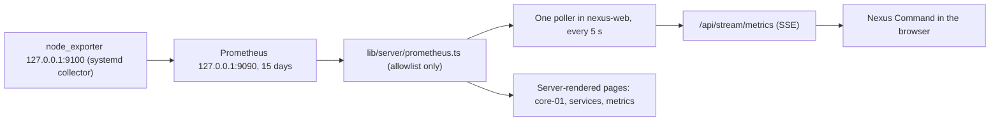

# Monitoring: Prometheus, node_exporter and Nexus Command

> **Purpose:** how server metrics flow from Nexus Core 01 to the Nexus Command pages, how to install and check the pipeline, and what to do when a number looks wrong.
> **Audience:** operators of Nexus Core 01 and developers of Nexus Command. Requirements: [spec 11](../spec/11-nexus-command.md).

## How it works



- **node_exporter** reports CPU, memory, disk, network and the state of the tracked systemd units. It was installed before this project with the systemd collector switched on for every unit; Task 8 adds a filter so it reports only the tracked units.
- **Prometheus** 3.16.0 (official release, sha256 verified) scrapes it every 15 seconds. It runs as user `prometheus` from `/usr/local/bin/prometheus`, configuration in `/etc/prometheus/prometheus.yml`, data in `/var/lib/prometheus`. The unit is sandboxed and its only writable path is the data directory.
- **The application** never sends PromQL text. `lib/monitoring/queries.ts` holds every expression under a query ID. `lib/server/prometheus.ts` accepts an ID, looks up the expression and refuses anything else before opening a connection. The live adapter in `lib/server/adapters/live.ts` turns the answers into a `Snapshot` (`lib/monitoring/snapshot.ts`).
- **One poller** (`lib/server/monitoring/poller.ts`) asks for a snapshot every 5 seconds while at least one browser is connected, and hands the result to all of them. After a failure it waits 10, 20, 40 and then 60 seconds, and returns to 5 seconds after the first success. This assumes a single `nexus-web` process.
- **The browser** (`components/command/use-metrics-stream.ts`) follows the stream. If the connection drops, `MetricsStreamClient` opens a new one after 1, 2, 4, 8, 16 and then 30 seconds.

## Tracked services

The list is `lib/monitoring/services.ts`. Each entry becomes one particle cluster and one table row.

| Service       | systemd unit            | Expected today              |
| ------------- | ----------------------- | --------------------------- |
| Apache        | `httpd.service`         | Running                     |
| Nexus Web     | `nexus-web.service`     | Running                     |
| MariaDB       | `mariadb.service`       | Running                     |
| PHP-FPM       | `php-fpm.service`       | Running                     |
| Postfix       | `postfix.service`       | Running                     |
| Dovecot       | `dovecot.service`       | Not running until Task 13   |
| SFTPGo        | `sftpgo.service`        | Not installed until Task 12 |
| Ollama        | `ollama.service`        | Running                     |
| Prometheus    | `prometheus.service`    | Running                     |
| node_exporter | `node_exporter.service` | Running                     |
| chrony        | `chronyd.service`       | Running                     |

"Not installed" (no series) and "Stopped" are shown as neutral, not as faults. A unit in `failed` state is shown as a fault. If the systemd collector reports nothing at all, every state reads "Unknown" and is drawn as "No recent data", never as running.

To track another unit, add it to `lib/monitoring/services.ts` **and** to `TRACKED_UNITS` in `infrastructure/scripts/setup-monitoring` (a unit test compares the two), then run the script again so node_exporter reports it.

## Install or repair

From the Mac:

```bash
infrastructure/scripts/server-run setup-monitoring
```

The script checks the target (hostname, IP, machine ID), downloads the latest Prometheus release and verifies its sha256 against the published sums, installs the binaries, configuration and unit, adds the systemd collector and the unit filter to the node_exporter unit if missing (backup: `/etc/systemd/system/node_exporter.service.nexus-bak-task8`), and waits for the first scrape. It stops with an error if either port is not on loopback, if `up{job="node"}` is not 1, or if no systemd unit is reported. Running it again changes nothing unless a file changed.

## Check the pipeline

Every allowlisted query against the real Prometheus, from the Mac through a tunnel:

```bash
ssh -N -L 19090:127.0.0.1:9090 root@10.26.64.164 &
NEXUS_PROMETHEUS_URL=http://127.0.0.1:19090 npm run monitoring:check
```

It prints one line per query and range, and exits non-zero if any is empty or fails. The only expected empty answer is `swap_used_pct` on a server without swap. The same check works on the server with the default address.

On the server:

```bash
systemctl status prometheus node_exporter --no-pager
ss -tlnp | grep -E ':(9090|9100) '          # both must show 127.0.0.1
curl -s 127.0.0.1:9090/-/healthy
journalctl -u prometheus -n 50 --no-pager
```

`infrastructure/scripts/smoke-test` also checks the listeners, the stream route's refusal of a Visitor, and that the readiness endpoint still passes.

## Reading the pages

| Page                | What it shows                                                                                                                    | Source                                    |
| ------------------- | -------------------------------------------------------------------------------------------------------------------------------- | ----------------------------------------- |
| `/command`          | Health summary, particle field, CPU, memory and root disk gauges, network and disk rates, service table, changes seen this visit | First reading from the server, then SSE   |
| `/command/core-01`  | Name, operating system, kernel, architecture, cores, memory, root disk, uptime, current use                                      | One reading per page load                 |
| `/command/metrics`  | Six charts for 1 hour, 6 hours, 24 hours or 7 days (`?range=1h\|6h\|24h\|7d`), times in Malaysia time                            | `query_range`, drawn on the server as SVG |
| `/command/services` | The service table                                                                                                                | One reading per page load                 |

Every page carries a **Live** or **Demo data** label. No page shows the real hostname or address: Core 01 is presented as "Nexus Core 01".

### Particle field

One cluster per tracked service. Health sets colour and motion:

| Health         | Look and motion                                         |
| -------------- | ------------------------------------------------------- |
| Running        | Green, slow orbit, tight                                |
| Changing       | Amber (starting or stopping), faster orbit, some jitter |
| Failed         | Red, fast orbit, strong jitter, widest spread           |
| Not running    | Grey, nearly still, small and dim                       |
| No recent data | Grey hollow rings, almost motionless                    |

Particles within 100 px of the pointer move away from it. The canvas is hidden from assistive technology; the service table below it carries the same states in text. Quality drops from high (36 particles per cluster) to medium (20) to low (10) when the device is weak or 60 frames average more than 20 ms. The loop pauses while the tab is hidden. With reduced motion set, the field draws one static frame and ignores the pointer.

The canvas exposes `data-state`, `data-tier`, `data-particles`, `data-frames` and `data-frame-ms` for tests.

### Stale data

Readings are stale when the newest one is older than three polling intervals (15 seconds). The age is the server's own: the stream sends the server clock with every event, so a wrong clock in the browser cannot make old data look fresh. When Prometheus cannot be reached, the poller keeps the last good readings and marks them unreachable, so they turn stale after 15 seconds and the page says "Prometheus does not answer". Stale values are drawn as "No recent data", never as healthy.

### Charts

Each chart has a legend (the second series is also dashed), a readout above the chart that follows the pointer, and the same readout with the Left, Right, Home and End keys when the chart has focus (Escape clears it). "Show the values as a table" opens the same values as text. Line colours are the design tokens `accent-ink` and `pink-ink`, which keep 3:1 against both themes.

## Demo mode

`NEXUS_MODE=demo` serves deterministic fixtures from `lib/fixtures/metrics.ts` through the same adapter interface and the same SSE message shape. Nothing is sent to Prometheus. Every value is labelled "Demo data". The sample server has a stopped Dovecot and a missing SFTPGo so the neutral states are visible.

## Access and limits

- `/api/stream/metrics` is Viewer and above (`metrics.stream` in `lib/server/policy.ts`). A Visitor gets 401. Each signed-in user may hold three streams; a fourth gets 429. The route sits under `/api/stream/`, which Apache proxies unbuffered with a one-hour timeout.
- The stream carries percentages, rates, unit states and timestamps. It carries no hostname, address or path.
- The metrics page reads `?range=` through an allowlist (`1h`, `6h`, `24h`, `7d`); anything else shows 1 hour. No browser request carries a query ID, so there is nothing to reject at request level; a code path that asks the client for an unknown ID throws `QueryNotAllowedError` before any network call.

## Settings

| Variable               | Default                 | Meaning                                               |
| ---------------------- | ----------------------- | ----------------------------------------------------- |
| `NEXUS_PROMETHEUS_URL` | `http://127.0.0.1:9090` | Where the live adapter reaches Prometheus (live mode) |

## Troubleshooting

| Symptom                                           | Likely cause and fix                                                                                                              |
| ------------------------------------------------- | --------------------------------------------------------------------------------------------------------------------------------- |
| Every service reads "Unknown" or "No recent data" | The systemd collector is off: `grep collector.systemd /etc/systemd/system/node_exporter.service`, then run `setup-monitoring`     |
| A service reads "Not installed" but is running    | Its unit name differs from `lib/monitoring/services.ts`; check `systemctl list-units --type=service` and the node_exporter filter |
| "Prometheus does not answer"                      | `systemctl status prometheus`; then `curl -s 127.0.0.1:9090/-/healthy`                                                            |
| Gauges show "No data" but services are fine       | The node scrape failed: `curl -s '127.0.0.1:9090/api/v1/query?query=up'`                                                          |
| Dashboard freezes behind Apache                   | A proxy is buffering: the route must stay under `/api/stream/` and send `X-Accel-Buffering: no`                                   |
| Charts say "No data for this range"               | Prometheus has not collected that long yet (a new install has only minutes of history)                                            |

## Related

[Spec 11](../spec/11-nexus-command.md) · [Server baseline](server-baseline.md) · [Configuration](configuration.md) · [Motion](../design/motion.md) · [Security](../security.md)
