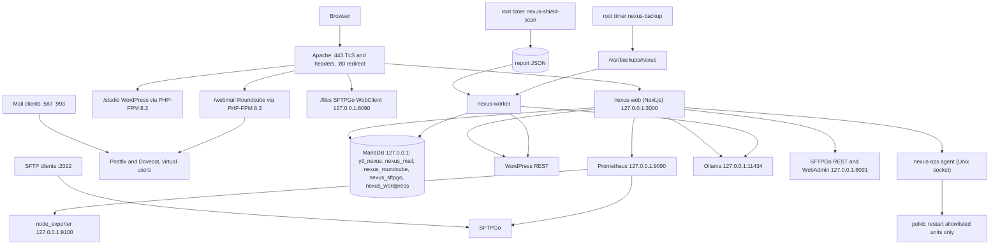

# YTL Nexus technology and architecture

> **Purpose:** how YTL Nexus is built: components, trust boundaries, key design decisions, repository layout, and the facts they rest on.
> **Audience:** builders, reviewers and the IT Infrastructure owners. Product requirements are in [`product.md`](product.md); repository placement is in [`structure.md`](structure.md); security controls are in [`security.md`](security.md); recorded decisions are in [`architecture/decisions/`](architecture/decisions/).

## 1. Shape

One Next.js application and a set of host services on a single Rocky Linux server (**Nexus Core 01**). Apache is the only public web entry point and routes by path. Every backing service listens on loopback or a Unix socket. See [ADR 0001](architecture/decisions/0001-modular-platform-on-one-host.md).

## 2. Trust boundaries

| Boundary                            | Rule                                                                                               |
| ----------------------------------- | -------------------------------------------------------------------------------------------------- |
| Internet or office network → Apache | TLS only; security headers; rate limits; only ports 22, 80, 443, 2022, 587 and 993 open            |
| Apache → Next.js                    | Loopback proxy; `ProxyPreserveHost On`; `X-Forwarded-Proto https`                                  |
| Browser → Next.js handlers          | Every page, Route Handler and Server Function authenticates, authorizes and validates input itself |
| Next.js → backing services          | Server-only adapters with least-privilege credentials from `/etc/ytl-nexus/*.env`                  |
| Next.js → operating system          | Only through the `nexus-ops` agent's three allowlisted operations; polkit is the final gate        |
| Root timers → application           | Root writes reports or INSERT-only rows; the web application only reads them                       |

## 3. Components

| Component        | Runs as                  | Purpose                                                 |
| ---------------- | ------------------------ | ------------------------------------------------------- |
| `nexus-web`      | `nexus`                  | Next.js app: every Nexus page and API                   |
| `nexus-worker`   | `nexus`                  | Scheduled checks, AI indexing, report ingestion         |
| `nexus-ops`      | `nexus-ops`              | Allowlisted restarts, bounded logs, health checks       |
| Apache httpd     | `apache`                 | TLS, headers, path routing, WordPress and Roundcube PHP |
| PHP-FPM pools    | `wordpress`, `roundcube` | One pool and system user per PHP application            |
| MariaDB 10.5     | `mysql`                  | All five databases                                      |
| Prometheus       | `prometheus`             | Metrics storage, 15-day retention                       |
| node_exporter    | `node_exporter`          | Host metrics                                            |
| Ollama           | `ollama`                 | Local models                                            |
| SFTPGo           | `sftpgo`                 | SFTP, WebClient, WebAdmin, REST API                     |
| Postfix, Dovecot | package users            | Internal mail                                           |
| Root timers      | `root`                   | Backups, restore tests, Shield scans                    |

## 4. Key design decisions

1. **Path routing on one hostname.** Apache excludes `/studio`, `/webmail` and `/files` (each served by Alias or its own proxy) and proxies everything else to Next.js. `ProxyPreserveHost On` and `X-Forwarded-Proto https`. SSE routes disable buffering (`flushpackets=on` plus `X-Accel-Buffering: no`). No extra DNS records are needed.
2. **Auth.** Better Auth with MariaDB, admin plugin with custom roles and impersonation off, mandatory TOTP for Operator and Administrator, rate limiting, `nextCookies()` last. One `requireRole()` guard everywhere; `requireStepUp()` with a 10-minute window for `/control`. Cookies `Secure`, `HttpOnly`, `SameSite=Lax`. Every auth event and mutation is audited. Spec: [10](spec/10-identity-and-access.md).
3. **Operations agent instead of a sudo helper.** `nexus-ops` runs unprivileged on a Unix socket readable only by group `nexus-ops-clients`. Requests are HMAC-signed with a timestamp and nonce. The schema allows only `restart(unit)`, `logs(unit, lines ≤ 500)` and `health(check)` over a fixed unit allowlist; a polkit rule permits only those restarts. Logs are sanitized. Restarts are asynchronous so `nexus-web` can restart itself. Spec: [12](spec/12-nexus-status-and-operations.md).
4. **Shield and Continuity run as root timers, never from the web.** They write JSON or INSERT-only rows; the worker ingests; the web reads. Nothing is remediated automatically.
5. **Metrics.** One in-process poller in `nexus-web` queries Prometheus on a fixed interval with fixed PromQL and fans out over SSE. This assumes a single `nexus-web` instance. Spec: [11](spec/11-nexus-command.md).
6. **AI.** SSE chat route; the worker chunks and embeds content into `ai_chunks` with audience and source; retrieval filters by role; retrieved text is untrusted data; no tools; limits protect the CPU. MariaDB 10.5 has no vector type, so embeddings are BLOBs with in-memory cosine search, which suits a few thousand chunks. Spec: [18](spec/18-nexus-ai.md).
7. **Mail.** Fresh Postfix and Dovecot with virtual users in `nexus_mail`, internal domain `ytl-nexus.internal`, LMTP delivery, loopback-only `mynetworks`, submission on 587, IMAPS on 993. Roundcube with a custom Elastic child skin. Spec: [17](spec/17-nexus-mail.md).
8. **WordPress.** Fresh headless install at `/studio` with the `nexus-content` plugin, signed revalidation webhook, preview tokens, Two Factor and IP-restricted admin. Spec: [15](spec/15-nexus-library-and-studio.md).
9. **Motion.** react-three-fiber point-shader particles, lazy-loaded and tiered; Motion for React for component transitions; view transitions where supported. Spec: [01](design-language.md).
10. **Server layout and deploy.** Releases in `/opt/ytl-nexus/{releases/<git-sha>,current,shared}`; environment files in `/etc/ytl-nexus/*.env` (`root:nexus`, 0640); SFTP storage on `sdb` at `/srv/nexus-transfer`; backups in `/var/backups/nexus`. `deploy.sh` on the Mac rsyncs a tagged commit to a new release directory, runs `npm ci && npm run build` **on the server** (Sharp and other native modules must match the server platform), runs migrations, swaps the `current` symlink, restarts and health-checks, rolling back automatically on failure. GitHub Actions runs checks only because GitHub cannot reach the private IP.
11. **Security baseline.** Internal CA certificate with SANs `ytl-nexus.ytlcomms.my`, `ytl-nexus.internal`, `sn1lyvx1d0002.ytlcomms.my` and `10.26.64.164`. HSTS, CSP (follow the installed Next.js CSP guide; if nonces force dynamic rendering of public ISR pages, document the trade-off), `X-Content-Type-Options`, `Referrer-Policy`, `Permissions-Policy`, `frame-ancestors`. Zod at every trust boundary, parameterized queries, rate limits on public handlers. systemd sandboxing (`NoNewPrivileges`, `ProtectSystem=strict`, `PrivateTmp`, minimal `ReadWritePaths`). firewalld allowlist. fail2ban for sshd, SFTPGo and Postfix with the owner's IP ignored. gitleaks in pre-commit and CI. SELinux stays disabled for the pilot and is a documented risk. Root SSH login and password SSH are reported by Shield but not changed (lockout risk).

## 5. Repository structure

[`structure.md`](structure.md) is the canonical map for repository directories, route ownership, module boundaries and file placement. Keep this technology document focused on runtime components and integrations.

## 6. Host facts (audit 2026-10-30; state after Task 4 in [`operations/server-baseline.md`](operations/server-baseline.md))

The table is the state **before** Task 4. Firewall, time sync, Node.js 24, PHP 8.3, loopback binding, TLS and the `nexus-web` service are now in place, and the old webmail, WordPress, FTP and container are gone; the baseline document is the current record.

| Item           | Value                                                                                                                                                                                                                                                                             |
| -------------- | --------------------------------------------------------------------------------------------------------------------------------------------------------------------------------------------------------------------------------------------------------------------------------- |
| Host           | 10.26.64.164, `sn1lyvx1d0002.ytlcomms.my`, QEMU/KVM guest                                                                                                                                                                                                                         |
| OS             | Rocky Linux 9.8, kernel 5.14                                                                                                                                                                                                                                                      |
| CPU            | 8 vCPU, Westmere-class, probably without AVX (confirm with `lscpu` in Task 4)                                                                                                                                                                                                     |
| Memory         | 15 GiB RAM, 5 GiB swap                                                                                                                                                                                                                                                            |
| Disk           | `/` 44 GB xfs (33 GB free); `sdb` 20 GB unused (verify empty before use)                                                                                                                                                                                                          |
| Network        | `ens3` 10.26.64.164/26                                                                                                                                                                                                                                                            |
| Security state | SELinux disabled; firewalld inactive; NTP sync disabled (breaks TOTP and TLS checks; fix first)                                                                                                                                                                                   |
| Runtimes       | Apache 2.4.62 (:80, :8443), PHP 8.1 with FPM via Remi (`php:remi-8.1` enabled), git, Podman. Node.js not installed                                                                                                                                                                |
| Module streams | `nodejs` 18, 20, 22, 24; `php` 8.1–8.3 (AppStream) and `remi-7.4` to `remi-8.6`                                                                                                                                                                                                   |
| Database       | MariaDB 10.5.29 listening on all interfaces                                                                                                                                                                                                                                       |
| AI             | Ollama on 127.0.0.1:11434 with only `tinyllama`                                                                                                                                                                                                                                   |
| Monitoring     | node_exporter on :9100, install method unknown                                                                                                                                                                                                                                    |
| Identity       | `sssd` running; check `realm list` before any hostname change                                                                                                                                                                                                                     |
| Old webmail    | Custom PHP: HTTP-only login, directory listing, downloadable admin JSON and PHP backup source, plaintext mailbox passwords in sessions, Apache-writable source, shared-code signup, passwordless root sudo helper; Postfix `mynetworks` trusted 10.26.64.0/24. Discarded entirely |

## 7. Technology notes

- **Next.js 16.3.5 self-hosting:** reverse proxy in front; `output: 'standalone'` (copy `public/` and `.next/static`); bind to loopback; graceful `SIGTERM` drain of 10–30 s. A single instance can use the local cache; multiple instances would need a shared cache handler, `deploymentId` and `NEXT_SERVER_ACTIONS_ENCRYPTION_KEY`. Route Handlers and Server Functions are public endpoints. Fetch is not cached by default; use tags and `revalidateTag`. Restrict `images.remotePatterns` to the WordPress uploads path. Server-only environment variables stay out of `NEXT_PUBLIC_`.
- **Better Auth:** email and password with a MySQL-compatible database; Next.js handler via `toNextJsHandler` with sign-up, email flows, impersonation and account administration switched off; Server Functions call `auth.api` for sign-in; `nextCookies()` last; admin plugin for roles and session revocation; `npm run auth:create-user` for the first admin; two-factor plugin for TOTP. Details: [Authentication, roles and audit](security/auth.md).
- **WordPress:** REST API; custom post types with `show_in_rest`; Application Passwords for server-to-server reads over HTTPS.
- **SFTPGo:** official YUM repository; unprivileged `sftpgo` user; MariaDB provider; passwords, multiple public keys, quotas, defender, per-protocol rate limits; per-binding WebAdmin, WebClient and REST API flags; Prometheus metrics. AGPL-3.0 with a proprietary UI theme, so its UI code and theme are never copied.
- **Prometheus:** `/api/v1/query` and `/api/v1/query_range`, called only with allowlisted PromQL.
- **Ollama:** embeddings API; Gemma 3 1B and 4B QAT need Ollama 0.6 or newer. Verify current models at install time.
- **Motion for React:** `MotionConfig reducedMotion="user"` and `useReducedMotion`.
- **Roundcube:** Elastic supports child skins; install the current stable complete tarball after verifying its signature or checksum.
- **Node.js:** 24 LTS on the server and in CI ([ADR 0002](architecture/decisions/0002-node-24-lts.md)).
